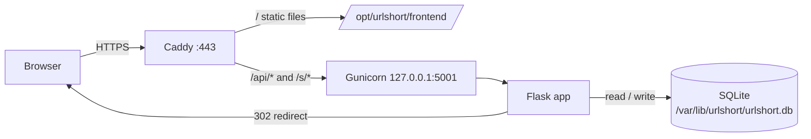
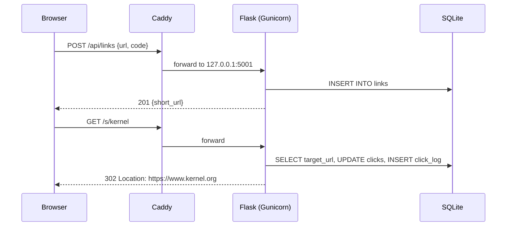
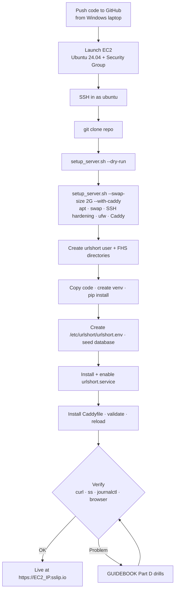

# Project 01 — URL Shortener

> Part of the **linux-devops-13-projects** curriculum · Runs on one AWS Free Tier EC2 instance (Ubuntu 24.04, 1 GB RAM)

A small, production-style URL shortener. Paste a long URL, get a short link like `https://<EC2_IP>.sslip.io/s/kernel`, and track how often it is clicked. The app is simple on purpose: the real goal is to learn how a Linux server is **prepared, secured, and run** in production.

---

## 1. Project Summary

| Item | Details |
|------|---------|
| **Frontend** | Static HTML, CSS and vanilla JavaScript |
| **Backend** | Python 3 + Flask, served by Gunicorn (2 workers) |
| **Database** | SQLite (single file, WAL mode) |
| **Reverse proxy / TLS** | Caddy (automatic HTTPS via sslip.io) |
| **Process manager** | systemd (`urlshort.service`) |
| **Automation script** | `scripts/setup_server.sh` |
| **Cost** | $0 — AWS Free Tier + free sslip.io DNS + free Let's Encrypt certificate |
| **RAM usage** | ~70 MB app + ~25 MB Caddy |

### Features
- Create short links with random or custom codes
- `302` redirect from `/s/<code>` to the original URL
- Click counter and click log (time, referrer, browser)
- List and delete recent links
- Health endpoint: `GET /api/health`

### Linux skills learned
- **FHS** — why code goes in `/opt`, config in `/etc`, data in `/var/lib`, logs in `/var/log`
- **apt** — repositories, GPG keys, installing and upgrading packages
- **Users and permissions** — system users, `chown`, `chmod`, `namei -l`
- **SSH hardening** — key-only login, no root login, safe reloads with `sshd -t`
- **Firewall** — AWS Security Group + `ufw`
- **Swap** — 2 GB swap file so builds don't crash the 1 GB box
- **systemd and journald** — running, enabling and reading logs for services
- **Reverse proxy** — routing by path, automatic TLS
- **Bash scripting** — `set -Eeuo pipefail`, traps, dry-run mode, idempotent steps

---

## 2. Architecture

```
                  AWS Security Group: 22 (my IP), 80, 443
 ┌───────────────────────────────────────────────────────────────────────────┐
 │  EC2 · Ubuntu 24.04 · ufw (deny incoming, allow 22/80/443)                │
 │                                                                           │
 │  ┌────────────────────┐  /api/*, /s/*  ┌──────────────────────┐  SQL   ┌─────────────────────────┐
 │  │ Caddy  :80 / :443  │ ─────────────▶ │ Gunicorn 127.0.0.1:5001│ ────▶ │ /var/lib/urlshort/      │
 │  │ user: caddy        │                │  ├─ worker 1 (Flask)  │        │   urlshort.db (SQLite)  │
 │  │ TLS: Let's Encrypt │                │  └─ worker 2 (Flask)  │        │ owner: urlshort         │
 │  └─────────┬──────────┘                │ user: urlshort        │        └─────────────────────────┘
 │            │ everything else           └──────────────────────┘
 │            ▼
 │  /opt/urlshort/frontend/  (index.html · app.js · style.css)
 └───────────────────────────────────────────────────────────────────────────┘
        ▲
        │ https://<EC2_IP>.sslip.io   or   http://<EC2_IP>
     Browser
```

### Server file layout (FHS)

| Path | Contents | Owner : Mode |
|------|----------|--------------|
| `/opt/urlshort/app/` | Flask code | `root:urlshort` · read-only for the app |
| `/opt/urlshort/venv/` | Python virtual environment | `root:urlshort` |
| `/opt/urlshort/frontend/` | Static website | `root:root` · `755/644` |
| `/etc/urlshort/urlshort.env` | Configuration | `root:urlshort` · `0640` |
| `/var/lib/urlshort/` | SQLite database | `urlshort:urlshort` · `0750` |
| `/etc/systemd/system/urlshort.service` | Service unit | `root:root` · `0644` |
| `/etc/caddy/Caddyfile` | Proxy config | `root:root` |
| `/etc/caddy/caddy.env` | `EC2_IP=...` used by Caddy | `root:root` |

---

## 3. Workflow Diagrams

### 3.1 Request flow



### 3.2 Short-link lifecycle



### 3.3 Deployment workflow



---

## 4. Prerequisites

### Accounts
- [ ] **AWS account** with Free Tier eligibility
- [ ] **AWS budget alert** (Billing → Budgets → zero-spend budget) so you are emailed before any charge
- [ ] **GitHub account** with the `linux-devops-13-projects` repository pushed

### On your laptop (Windows)
- [ ] **OpenSSH client** (built into Windows 10/11 — check with `ssh -V`)
- [ ] **Git** (`git --version`)
- [ ] **VS Code** (optional, recommended)
- [ ] The EC2 key pair file, e.g. `ec2-devops.pem`, stored in `%USERPROFILE%\.ssh\`

### EC2 instance
| Setting | Value |
|---------|-------|
| AMI | Ubuntu Server 24.04 LTS (x86_64) |
| Instance type | `t3.micro` or `t2.micro` (whichever your free tier covers) |
| Storage | 15 GB gp3 |
| Key pair | ED25519, `.pem` |

### Security Group (inbound)
| Type | Port | Source | Why |
|------|------|--------|-----|
| SSH | 22 | **My IP** only | Admin access |
| HTTP | 80 | 0.0.0.0/0 | Plain HTTP + Let's Encrypt challenge |
| HTTPS | 443 | 0.0.0.0/0 | The website over TLS |

> ⚠️ **Never** open port `5001`. The app listens only on `127.0.0.1`.

### Things to know before starting
- Basic Linux commands: `cd`, `ls`, `cat`, `sudo`, `nano`
- The server must be running **real systemd** (PID 1). Check with `ps -p 1 -o comm=` → must print `systemd`. If it doesn't, you are in WSL or a container, not on EC2.

---

## 5. Requirements

### System packages (installed by `setup_server.sh`)
```
ca-certificates curl wget git unzip jq htop tree ncdu
ufw unattended-upgrades apt-listchanges
python3 python3-venv python3-pip sqlite3
gnupg debian-keyring debian-archive-keyring apt-transport-https
caddy   (from the official Caddy apt repository
